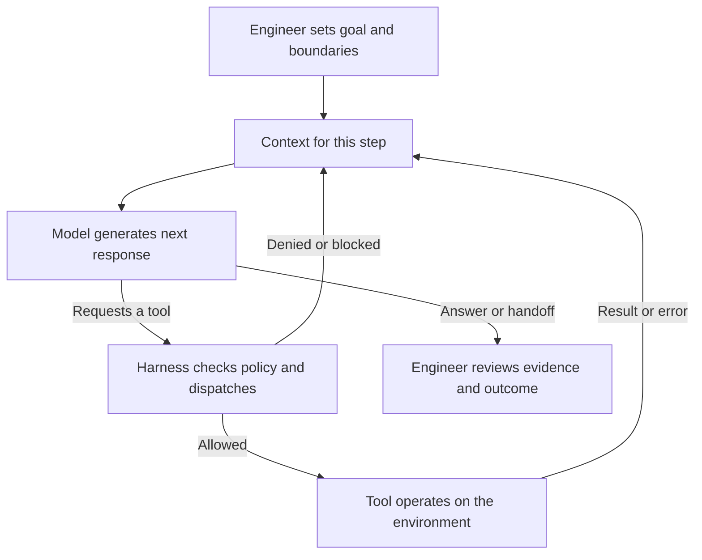

# 2. Agentic engineering foundations

**Draft v0 — ready for discussion.** Builds on the first OMP task. The explanations, exercise and suggested timing are proposed for review.

Models, agents, tools, context and harnesses; what the engineer owns.

## Look inside the task you just completed

In section 1, you followed a small task: make a project-name filter work. Whether you operated OMP, watched the presenter or inspected the prepared solution, you connected a request to code changes and checks.

Now imagine repeating that task with the same model, but removing its way to run tests. It could still propose the right code. What evidence would be missing from its final report?

Or keep the tools and remove the requirement to search names only. Would matching an owner's name necessarily look like a mistake to the agent?

These changes reveal the parts of the system. Understanding them helps you make better requests, spot missing information and decide what to investigate when a run goes wrong.

For this course, **agentic engineering** means applying engineering judgment to work carried out with agents: deciding the goal, preparing the conditions for useful work, and evaluating the result. Writing the prompt is one part of that responsibility.

## What you will be able to do

- Identify the model, agent, tools, context and harness in an OMP task.
- Trace how a tool result becomes information for the next model call.
- Distinguish a proposed action, an executed action and a verified outcome.
- Diagnose a simple failure without assuming that changing the model will fix it.
- Explain the decisions the engineer still owns.

**Suggested format:** 40–50 minutes of explanation, discussion and an optional trace exercise, using the section 1 example. This is a planning estimate to test in a pilot. A completed live OMP run is useful but unnecessary: the companion worksheet includes a prepared teaching trace.

## 1. Five parts, one concrete example

Product terminology varies. We will use these working definitions throughout the course:

| Part | What it means | In the filter task |
| --- | --- | --- |
| **Model** | The trained system that generates a response or requests an action from the information supplied to it. | Proposes reading the filter, suggests an implementation, or interprets a test failure. |
| **Tool** | A callable operation with inputs and a result, sometimes including a side effect. | Reads `public/filter.mjs`, applies an edit, or invokes the test command. |
| **Context** | The information supplied for the current model interaction. | Instructions, the task, relevant file contents, tool definitions and recent test output. |
| **Harness** | The software around the model that coordinates the run. | OMP assembles context, exposes tools, handles execution and configured approvals, and manages the session. |
| **Agent** | The running system in which a model can choose actions, receive feedback and continue toward a goal. | The OMP session working on your filter through successive steps. |

The agent is the system at work. The harness provides the machinery supporting that work. Choosing a different model inside OMP changes one component; it does not automatically change the tools, project files or acceptance criteria.

**Quick check:** place each of these into the table: the selected model's name, a failing assertion, the shell operation that ran the tests, and OMP's decision to request permission. A test failure is feedback that can enter context; it is different from the tool that produced it.

## 2. Follow one lap of the agent loop

An agent can choose its next action from what it has learned so far. A **predefined workflow** fixes more of the sequence in code. Our test command follows a predefined set of checks; the agent may decide which file to inspect after a failure. Both can exist in the same task. This distinction follows [Anthropic's introduction to agents and workflows](https://www.anthropic.com/engineering/building-effective-agents).

Here is a simplified view of the loop:

The harness coordinates the model calls and feedback in this diagram. A run can also end through interruption, a runtime limit or an error; it does not always reach a successful final answer.

Consider the padded query `  ATLAS  ` from section 1. An illustrative sequence might be:

1. The model requests the filter source; a read tool returns its contents.
2. The model requests an edit; the harness checks the applicable policy and the tool applies it if allowed.
3. The model requests `npm test`; the shell runs the test process and returns output.
4. A whitespace check fails. That result is available when the model chooses its next response.
5. The model requests a correction, then another test run, and reports the observed result.

This is a teaching example, not a claim about the order of your own run. The agent may solve the task on its first attempt or take another route.

Notice three separate statements: **“I will run the tests,” “the test command ran,” and “the checks passed.”** Each needs different evidence. Even the last statement applies only to the checks that actually ran against that version of the code.

## 3. Enough model background to make better decisions

A large language model learns patterns during training. During use—often called **inference**—it processes the supplied context and generates output in tokens. For text, tokens are pieces of text; they need not correspond to whole words. The output can include prose, code or a structured tool request. Training and generating a response are different activities. [3Blue1Brown's introduction](https://www.3blue1brown.com/lessons/mini-llm/) provides the visual background.

For engineering work, three consequences matter:

- **General knowledge needs project evidence.** Knowing JavaScript does not establish how this repository defines search. In our app, accent folding is outside scope even if the model has seen other search features that include it.
- **Plausible output still needs checking.** An explanation can sound convincing while describing the wrong file, an API that is unavailable here, or a test that was never run.
- **Repeated requests can take different paths.** Sampling, the supplied context, model settings and changes in the environment can affect a run. Record those conditions when comparing results.

The model may infer that “search” includes owners. The existing contract says names only. You improve this task by making that requirement available and checking it, rather than relying on a model to guess the product decision.

**Discuss:** if an agent produces a valid-looking implementation that violates a requirement it was never given, what would you change before the next attempt?

## 4. Context is what reaches the model

The model's input is larger than the message you typed. It may contain operating instructions, repository guidance, tool descriptions, earlier conversation and retrieved information. It still has a finite context budget. Adding more material can introduce stale or conflicting details; relevant information has to be selected and kept current. [Anthropic's context-engineering guide](https://www.anthropic.com/engineering/effective-context-engineering-for-ai-agents) develops this idea.

In the filter task, distinguish three places information can live:

| Where | Example | What you can rely on |
| --- | --- | --- |
| Learned model parameters | Familiarity with common JavaScript patterns. | General capability, not evidence about the current file. |
| Current context | The filter contents returned by a read tool. | Information supplied for this interaction, subject to omissions and interpretation errors. |
| Persistent project or session storage | `contract.md`, saved notes or an older transcript. | Information that may be retrieved; its existence alone does not prove it was supplied this time. |

OMP can discover supported instruction files automatically, with configuration and precedence rules. Other files may need to be read explicitly. That is why “the file exists” and “the relevant contents reached the model” are separate claims. See [OMP's context-file documentation](https://github.com/can1357/oh-my-pi/blob/main/docs/context-files.md).

Saving a note does not by itself retrain the model. A later session benefits when the note is loaded or retrieved. Similarly, a conversation summary may omit a detail that was present earlier. We will practice maintaining repository knowledge and handoffs in section 4.

**Choose the useful context:** you want to understand why `team` must return no projects. Which helps more: the whole history of the app, or the name-only requirement alongside the record whose owner is “Atlas team”? Explain why.

## 5. Tools and harnesses make action possible

When the model requests an edit, software has to turn that request into a file change. The request might be allowed, denied, malformed, or fail because the file has changed. The tool returns a result that the next step can use.

A tool can succeed at its operation while the task remains incomplete. Writing a file successfully does not establish correct behavior. A test process can also fail because its environment is unavailable, before it checks the feature at all.

In section 1, OMP provided the tool interface and approval handling. The project supplied the code, instructions and tests. The operating environment determined what the process could actually access. These layers work together; a sentence in a prompt does not create a filesystem sandbox. The [OMP approval reference](https://github.com/can1357/oh-my-pi/blob/main/docs/approval-mode.md) explains its configured checks.

**Imagine changing one part:** keep the same model but remove every way to execute the tests. The agent can inspect test code and suggest what should happen. To claim a fresh test result, it needs execution evidence—from a permitted tool or from a person who ran the checks and supplied the output.

You do not need to build a custom harness to use these ideas. First learn to recognize what your existing environment provides. Advanced harness design belongs in section 8.

## 6. What the engineer owns

The agent can do substantial work: investigate, implement, suggest tests and explain tradeoffs. The engineer remains responsible for deciding what the work is meant to achieve and whether the evidence supports accepting it.

| Responsibility | Decision in this example |
| --- | --- |
| **Intent** | Search project names; owner search would be a different requirement. |
| **Scope and authority** | Permit the small filter change and appropriate local checks. |
| **Relevant context** | Supply the current contract and help resolve missing or contradictory information. |
| **Quality and verification** | Read the implementation, assess what tests cover, and check the browser behavior. |
| **Acceptance and next action** | Accept, request another change, or say what remains unverified. |

Suppose the tests pass, but someone asks for `cafe` to match `Café`. That request raises a product decision about accent handling. The agent can explain options; the team must agree the behavior before calling the existing implementation wrong or expanding the change.

Tool output also has a scope. A passing filter test is evidence about that function. It does not establish that the page was refreshed, keyboard interaction was checked, or the feature should be released. Being precise about what you know is part of the engineering work.

## Optional project: explain the run

Open the [agent-loop worksheet](../demo/section-02-agent-loop.md). It works with your section 1 transcript or a clearly labelled prepared trace, so everyone can participate without making another model call.

In pairs, one person identifies the actions and feedback; the other challenges the evidence behind each claim. Then swap roles. Working alone, write your answers before opening the discussion notes.

You will produce a small annotated trace, diagnose a missing requirement and a missing execution capability, and name the human decision still needed at the end. The aim is to explain the system's behavior, rather than reproduce the wording of a particular OMP run.

## Before you move on

Answer these without looking at the definitions:

1. What would change if you selected a different model inside the same OMP setup? What would remain in place?
2. How does a test failure reach the next model interaction?
3. Why does a saved `contract.md` file not guarantee that its contents were used?
4. What evidence would you request before accepting “the feature is complete”?

A strong answer identifies the model as one component, follows execution feedback into context, accounts for loading or retrieval, and connects acceptance to the agreed behavior and actual checks.

Section 3 will turn these foundations into an everyday workflow: explore, specify, plan, implement, verify and review.

[Previous: Getting started with OMP](01-getting-started-with-omp.md) · [Back to the outline](../OUTLINE.md) · [Next: The everyday workflow](03-the-everyday-workflow.md)

## Resources, videos and links

### Reading

- **Start here:** [Building effective agents — Anthropic](https://www.anthropic.com/engineering/building-effective-agents). Read “What are agents?” and “Agents” for the workflow distinction and feedback loop. The article dates from 2024; use it for the concepts rather than a current product catalogue.
- **Model background:** [Large Language Models explained briefly — 3Blue1Brown](https://www.3blue1brown.com/lessons/mini-llm/). A visual written introduction to generation and training, accompanying the video below.
- **Optional depth:** [Effective context engineering for AI agents — Anthropic](https://www.anthropic.com/engineering/effective-context-engineering-for-ai-agents). Read the opening explanation and “Context engineering vs. prompt engineering”; save its longer-task techniques for later sections.

### Videos

- **First choice:** [Large Language Models explained briefly — 3Blue1Brown](https://www.youtube.com/watch?v=LPZh9BOjkQs). Watch for the difference between training a model and using it to generate a response. Afterwards, identify which parts of our OMP loop sit outside the model.
- **Optional longer background:** [Intro to Large Language Models — Andrej Karpathy](https://www.youtube.com/watch?v=zjkBMFhNj_g). A lecture presented as a one-hour introduction, linked from [the author's site](https://karpathy.ai/). Use it to deepen the model background; its historical product examples are not a guide to today's OMP setup.

Neither video is required for the exercise. Specific teaching excerpts and timestamps remain to be selected during presenter preparation.

### Useful links

- [Agent-loop worksheet and discussion notes](../demo/section-02-agent-loop.md) — the optional activity for this section.
- [OMP repository](https://github.com/can1357/oh-my-pi) — connect the general concepts to the environment used in the course.
- [OMP context files](https://github.com/can1357/oh-my-pi/blob/main/docs/context-files.md) — how supported instructions are discovered and loaded.
- [OMP approval modes](https://github.com/can1357/oh-my-pi/blob/main/docs/approval-mode.md) — where tool requests meet configured execution policy.
- [Section 1 lab setup](../demo/section-01-setup.md) — return here if you want a fresh local example to inspect.
