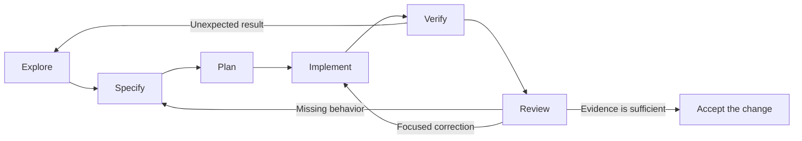

# 3. The everyday workflow

**Draft v0 — ready for discussion.** The practical core of the course, developed in greater depth at Petar's request. Examples and delivery timings remain draft choices.

Explore, specify, plan, implement, verify and review.

## From a request to a change you can stand behind

“Make it easier to clear the search.”

The agent can start writing code immediately. But there are several reasonable interpretations: add a button, clear on Escape, clear when the page reloads, or remove the search entirely. Even after choosing a button, someone must decide what happens to the result count, the empty message and keyboard focus.

This section teaches you to take that ordinary, incomplete request through a complete engineering change. OMP helps you investigate and implement. You make the intended behavior clear, choose useful checks, and decide whether the result meets the need.

By the end, you should be able to handle a small feature or defect from first investigation through a reviewable result—and explain why you accept it.

## How to use this section

Follow the **Clear filter** example through the six stages below. Then complete the [optional project lab](../demo/section-03-workflow-lab.md), or choose a transfer exercise from the [worked examples](../demo/section-03-worked-examples.md).

The examples cover a UI feature, a whitespace regression, an API change, a refactoring, a data import, CI investigation, documentation and a dependency update. The non-demo repositories and their requirements are fictional teaching scenarios. Prompts are starting points to adapt after inspecting your own project.

**Suggested delivery:** two workshops of 75–90 minutes, with a break between them. Use the first for the guided workflow and the second for practice and review. Additional examples and resources are a reference library, not required reading in one sitting. Pilot these estimates before setting the course duration.

Bring the concepts from sections 1 and 2. We will use OMP and ordinary Markdown; no additional specification framework is needed.

## The workflow at a glance

| Stage | The question you are answering | Useful result |
| --- | --- | --- |
| **Explore** | What happens now, and where does it happen? | A small map of the relevant code, current behavior and checks. |
| **Specify** | What should change, and what must remain true? | Observable examples, scope and resolved product decisions. |
| **Plan** | What is the smallest coherent route to that result? | A short sequence connecting edits to checks. |
| **Implement** | Can we make that change without introducing unrelated work? | A focused implementation and appropriate tests. |
| **Verify** | What evidence shows the intended behavior works? | Actual results from the relevant automated and manual checks. |
| **Review** | Does this change deserve to be accepted? | A decision supported by the diff, behavior and remaining limitations. |



These are thinking stages, not six mandatory meetings or six mandatory prompts. A familiar correction may need one concise request. An unfamiliar change benefits from a pause after investigation. Continue within already agreed scope; involve the engineer when a decision, conflict or wider action needs their judgment.

The diagram includes loops because learning changes the plan. Finding the wrong assumption early is progress.

## The worked example: Clear filter

Start with the project directory from section 1 **with its filter already working**. It shows Atlas, Atlas API, Borealis and Café. The supplied 11 automated checks pass on the prepared starting implementation.

The request is to add an explicit **Clear filter** button. A user should be able to return to the full list and immediately type another query.

This is a new task. Its scope includes the page and event handling, unlike section 1's filter-only exercise. The [lab guide](../demo/section-03-workflow-lab.md) prepares the correct starting copy and makes that scope explicit.

## 1. Explore: earn a useful picture of the code

Begin with the current behavior. Open the app, search for `Atlas`, then search for `team`. Find where the query reaches the filter and how the list updates. Read the project instructions and test commands before running them.

### A prompt for focused exploration

```text
We are adding an explicit Clear filter button to this project directory.
First inspect the working app; do not change files yet.

Read AGENTS.md, contract.md, package.json, public/index.html,
public/app.mjs, public/filter.mjs and the relevant tests.
Trace how input changes update the list, count and empty state.
Run the existing local test command from the lab root.

Report the relevant files, current behavior, what the tests cover,
and any decisions that would materially change the implementation.
Separate observations from assumptions. Keep the report concise.
```

This request authorizes local inspection and the existing tests, while reserving implementation for the next step. It does not ask the agent to review the entire repository or invent a new architecture.

### What a useful exploration result looks like

This is an illustrative report, not a transcript of a live run:

```text
index.html defines the labelled search input and result containers.
app.mjs listens for input events and calls render().
render() updates the list, count and empty-state message.
filter.mjs already implements the accepted name-matching behavior.

The existing tests exercise filter rules and basic HTTP responses.
They do not exercise a Clear button or keyboard focus.

Decision needed: should clearing return focus to the search input?
```

A real report must also state the actual baseline test result. Do not copy a success count from this lesson into an unobserved run.

**Stop and predict:** if we only assign an empty string to the input, will the existing `input` event listener necessarily run? Keep that question for implementation and verification.

### When exploration is enough

You can identify the behavior's entry point, the code that changes state, the checks you can run and the important unknowns. A file listing alone is insufficient; a twenty-page repository tour is unnecessary for this change.

If the baseline fails, distinguish an existing defect from a setup problem before editing. Record the command, working directory and relevant output. A test process that cannot start has not demonstrated a feature failure. For a large project, begin with the relevant baseline checks and follow its required validation policy; running everything indiscriminately can be wasteful. See [First run the tests](https://simonwillison.net/guides/agentic-engineering-patterns/first-run-the-tests/) for this habit.

## 2. Specify: turn intent into observable examples

“Add a button” describes an interface element. “Return to the full list and continue searching” describes the useful outcome. Connect them with a few examples that would expose plausible mistakes.

For this worked example, the course chooses the following behavior. In a real project, agree these decisions with the person responsible for the feature.

### The accepted behavior for this exercise

| Situation | Expected result |
| --- | --- |
| The page first opens | A visible button labelled `Clear filter` is disabled because the input is empty. |
| The input contains any characters, including spaces | The button is enabled. Its state follows the raw input value, not the number of matching projects. |
| A user activates Clear filter after `Atlas` | Input becomes empty; all four projects return in source order; count is `4 of 4 projects`. |
| A user activates it after `team` | The no-results message disappears along with the old query; all four projects return. |
| A user activates it with the keyboard | The result is the same as clicking; focus returns to the search input so typing can continue. |
| A user manually deletes the whole query | The full list returns and the button becomes disabled. |
| A user types a new query after clearing | Existing name-only, case-insensitive, trimmed matching still works. |

Use a native button. Clearing should update the existing page without a reload or a new application request. Name matching, owner matching, accent handling, source data and result ordering stay as defined in `contract.md`.

**Why spaces matter:** a whitespace-only query already shows all projects. There is still text to remove. A button that disables itself whenever all four rows are visible would be wrong for both spaces and some ordinary queries.

### A prompt for checking the specification

```text
Review these Clear filter acceptance examples against the current app.
Identify contradictions, missing behavior that would change the design,
and any example that cannot be observed as written.
Do not add features or implement yet.

For this task, the button is visible, disabled only for an exactly empty
input, and returns focus to the search input after activation.
All existing matching rules remain unchanged.
```

Ask for clarification on consequential ambiguity. Decide ordinary implementation details from the established project patterns. Do not turn every small choice into an approval request.

### Separate the requirement from one implementation

“The empty message disappears” is required behavior. “Call `render()` from the click handler” is an implementation choice suggested by this app. Keeping those separate lets a test reject the wrong behavior without forcing one internal design.

For a larger change, write the agreed examples in a short Markdown note. For this small task, the request and example table can be sufficient. [Gojko Adzic's guidance on key examples](https://gojko.net/2014/05/05/focus-on-key-examples/) explains why a few revealing cases are more useful for discussion than an enormous list of variations.

## 3. Plan: connect each edit to a reason and a check

A useful plan names the changes that matter. It should help you spot missing work and unnecessary scope before the diff grows.

### A plan for the worked example

1. Add a labelled native button beside the existing search control in `public/index.html`.
2. In `public/app.mjs`, keep the button's disabled state in sync with the raw query value.
3. Handle activation by clearing the value, updating the existing results and returning focus to the input.
4. Add only the styling needed to make the button usable and its focus state visible, if existing styles are insufficient.
5. Run the existing suite, then exercise the acceptance examples in the browser. Record what was checked and inspect the entire change.

The plan leaves `public/filter.mjs` alone because matching is already correct. It does not add a UI framework, another source of query state or a separate filtering implementation.

### A planning prompt

```text
Propose the smallest implementation plan for the agreed Clear filter behavior.
For each step, name the likely file, why it changes and how we will check it.
Reuse the existing result-rendering path if appropriate.
Call out anything that requires a dependency, wider scope or a new decision.
Do not implement until I have reviewed this plan.
```

We pause here in the guided exercise so learners can critique the plan. That pause is a teaching choice. Once scope and approach are clear, an everyday request can authorize the agent to proceed through the plan without stopping at every line.

**Plan review exercise:** the agent proposes replacing the app with a component framework “to make future changes easier.” What evidence would justify that change for this request? If there is none, ask for the small version and keep any broader idea as separate work.

### Match planning depth to uncertainty

| Task | Enough planning might be |
| --- | --- |
| Correct one visible typo | Confirm the intended wording and location; edit and inspect. |
| Add Clear filter | A few steps covering control state, rendering, focus and verification. |
| Change an API default | Identify callers, compatibility behavior, tests and how to release the change safely. |
| Investigate a slow build | First plan a measurement and one experiment; the code change is not known yet. |

Use the simplest adequate process. [Anthropic's workflow guidance](https://code.claude.com/docs/en/best-practices) also distinguishes small direct changes from work that benefits from exploration and planning. Its product commands are Claude-specific; the prompts in this lesson are ordinary requests to OMP.

## 4. Implement: keep the change coherent

With the behavior and scope settled, authorize the work clearly:

```text
Implement the reviewed Clear filter plan in this disposable lab.
This is a new section 3 task: you may change public/index.html,
public/app.mjs and, if needed, public/style.css.

Keep filter.mjs, the synthetic data and the accepted tests unchanged.
Add no dependencies. Use the acceptance examples we agreed.
Run npm test. I will perform the browser checks with the provided guide.
Do not claim those browser checks ran unless you actually performed them
through an available, authorized tool and can report the observations.

Continue through ordinary corrections within this scope.
If the same failure persists after one correction, or you need to widen
the change, stop with the evidence and the decision needed.
Finish with the changed files, actual checks and remaining work.
```

The supplied tests are preserved in this particular lab so they continue to protect existing behavior. In a real feature, adding or updating relevant tests is normally part of implementation. Test expectations should change when an agreed requirement changes—not merely because the current code fails them.

### A small mistake worth understanding

This candidate is deliberately incomplete:

```js
clearButton.addEventListener('click', () => {
  query.value = '';
});
```

It clears the text but does not explicitly refresh the list, count or empty state. Programmatically setting an input's value does not fire an `input` event. The existing event handler therefore cannot be assumed to update the page. See the [input-event reference](https://developer.mozilla.org/en-US/docs/Web/API/Element/input_event).

For this app, a focused correction can use the existing render function and restore focus:

```js
clearButton.addEventListener('click', () => {
  query.value = '';
  render();
  query.focus();
});
```

This is only a fragment: the control must also exist and its enabled state must stay synchronized. The [lab guide](../demo/section-03-workflow-lab.md) includes the reference changes after the exercise.

### Use tests to challenge the implementation

When an automated test is appropriate and the project has a suitable test environment, start with a behavior that should fail before the change. Confirm it fails for the intended reason, implement the behavior, then run the relevant checks again. [Red/green TDD](https://simonwillison.net/guides/agentic-engineering-patterns/red-green-tdd/) describes this pattern for agents.

For the Clear button, the existing Node suite does not drive a browser. The core lab uses an explicit browser procedure for the new behavior. A project already using Playwright can automate it; a worked example is included in the companion examples. Adding a browser-test stack is a separate setup decision, not an invisible prerequisite.

Do not write a test that merely checks whether the implementation calls `render()`. Check the observable result it is meant to produce. Likewise, a test that copies the same wrong requirement as the implementation can pass while the feature is wrong.

## 5. Verify: assemble evidence for the actual claim

Verification begins before coding: the baseline tells you what already worked. After coding, verify both the new behavior and the existing behavior the change might affect.

### The green-test trap

The starting app passes all 11 supplied tests and has no Clear filter button. Therefore, “11 tests pass” cannot demonstrate that the new button works. It tells you that the existing checks still pass.

That is useful regression evidence. It needs to be combined with checks that exercise the new interaction.

### Verification matrix for Clear filter

| Claim | Check | A plausible mistake it catches |
| --- | --- | --- |
| Existing filtering still works | Run `npm test` and retain its actual output. | Accidental changes to matching or application assets. |
| The new control exists and reflects query state | Inspect the empty page, type a query, then manually erase it. | A permanently enabled or disabled button. |
| Clearing refreshes the whole result area | Search `team`, activate Clear, inspect rows, count and empty message. | Text clears while stale results remain. |
| Keyboard users can continue searching | Tab to the enabled button, activate it, and type a new query without clicking the input. | Missing keyboard activation or lost focus. |
| Spaces are removable | Enter spaces and use Clear. | Disabled state based on trimmed text or result count. |
| The change stays local | Observe clearing with the browser's network view open. | A reload or new request added unnecessarily. |

Run the browser sequence against the updated app, refreshing first to load changed JavaScript. The lab guide gives the exact steps. Keyboard checks are useful evidence, but do not by themselves constitute a full accessibility audit.

### A prompt for interpreting evidence

```text
Compare the actual verification results with our acceptance examples.
For each example, mark verified, failed or not checked and point to evidence.
Distinguish the existing Node tests from the new browser interaction checks.
Investigate a mismatch before proposing a correction.
Do not change a test expectation just to match the implementation.
```

If you find a defect, reproduce it, identify what the result contradicts, make the smallest relevant correction, and rerun the affected check plus the required regression checks. Once those pass, repeat broader checks only when the change or remaining uncertainty justifies it.

### What an evidence note should say

Use this structure, filling in observed results:

```text
Code state / starting revision:
Command and working directory:
Result and relevant output:
Browser and app instance:
Interactions observed:
Checks not run:
Remaining uncertainty and next action:
```

“It works” is too broad to help a reviewer. “After `team`, Clear restored four rows, removed the empty message and returned focus to the input” is a claim someone can inspect or repeat. [Agentic manual testing](https://simonwillison.net/guides/agentic-engineering-patterns/agentic-manual-testing/) offers further examples of exercising code beyond its unit tests.

## 6. Review: decide whether to accept the change

Review the request, the diff and the evidence together. The implementation can be tidy and still solve the wrong problem; the feature can work once and still contain an avoidable regression.

In the fresh lab, before making any new commits:

```sh
git status --short
git diff HEAD --stat
git diff HEAD -- public/index.html public/app.mjs public/style.css
git diff HEAD --check
```

Comparison with `HEAD` includes staged and unstaged changes to tracked files. Status also surfaces new files, which you should open and review. In normal project work, if commits have already been made, compare against the recorded starting revision or the appropriate PR base; `HEAD` alone would omit committed work. See the [Git diff reference](https://git-scm.com/docs/git-diff).

### Questions that make a review useful

- Does each change contribute to the agreed behavior?
- Does every way of changing the input keep button state and results consistent?
- Does the button preserve native keyboard behavior and visible focus?
- Is the existing rendering path reused sensibly, without a second competing state model?
- Do the checks distinguish correct behavior from the likely mistakes?
- Are the reported results from this code state? What remains unverified?

Review depth should follow the change. Google's [code-review guidance](https://google.github.io/eng-practices/review/reviewer/looking-for.html) is useful for design, behavior, complexity and test quality. An agent review is another source of findings; it does not independently establish correctness just because it is confident.

### A focused review prompt

```text
Review the current diff against the agreed Clear filter examples.
Do not edit files. Focus on behavior, state synchronization, keyboard
interaction, regressions and gaps in the supplied evidence.
For each finding, identify the file/location, the observable consequence,
and a scenario that demonstrates it. Separate defects from optional ideas.
If you find no defect, state the checks and limitations of your review.
```

This can be a separate review request in OMP or a review performed by another engineer. You do not need a swarm for a small button change.

### Turn vague feedback into an actionable comment

| Weak comment | Useful comment |
| --- | --- |
| “The state handling seems wrong.” | “After searching `team`, this handler empties the input but leaves the no-results message visible. Update the rendered results as part of clearing and check that sequence.” |
| “Add more tests.” | “The checks never exercise whitespace-only input. That case distinguishes a button enabled by raw text from one enabled by trimmed text.” |
| “This is overengineered.” | “This adds a second query store although the existing input and render path can support the feature. What requirement needs that additional state?” |

### Finish with a reviewable handoff

A short change description should explain the problem, resulting behavior, important choices and actual validation. [Writing good change descriptions](https://google.github.io/eng-practices/review/developer/cl-descriptions.html) offers a useful reference.

```text
Problem: users need an explicit way to clear the project-name query.
Change: added Clear filter, synchronized it with input state, reused
the result-rendering path and returned focus to the search input.
Validation: [actual commands/results and browser observations].
Limitations: [checks not completed or known constraints].
Decision needed: [acceptance, further work, or none within this scope].
```

The sample describes the intended change; its validation fields must be completed from a real run. Producing a draft PR description does not publish or merge anything. Follow the project's authorization and review process for those actions.

## When the request changes halfway through

Halfway through the button work, someone says, “Also make `cafe` match `Café`.” This changes filtering semantics, not just how the query is cleared.

Recognize it as a new decision. Ask whether to include it now or keep it as a separate change. If included, update the accepted examples and scope before implementation; the old accent test would need an intentional, explained change. If deferred, keep the current behavior and record the follow-up.

```text
The Clear filter task keeps existing matching behavior.
Accent-insensitive matching changes contract.md and the accepted accent test.
Please outline the additional behavior and checks, without changing code.
We will decide whether to include it or handle it separately.
```

If the user has already clearly authorized the expanded behavior, proceed within that revised scope and update the evidence. Avoid asking them to repeat an authorization they have already given.

## Transfer the workflow to other work

The [worked examples](../demo/section-03-worked-examples.md) develop these cases with prompts, expected artifacts, counterexamples and review decisions:

| Example | The main lesson |
| --- | --- |
| Whitespace regression | Reproduce the reported symptom and preserve a regression check. |
| API result limit | Specify validation and compatibility before changing a handler. |
| Refactoring name normalization | Define the behavior to preserve before changing structure. |
| Importing duplicate records | Resolve the meaning of “duplicate” with concrete data. |
| Slow or flaky CI | Measure and explain the failure; a lucky retry is not a repair. |
| Documentation correction | Verify instructions against actual behavior. |
| Dependency update | Inspect the target release and resulting lockfile; do not turn one update into an unrelated upgrade. |

For a small, clear bug fix, the whole workflow may fit in one request:

```text
Pasted queries such as "  ATLAS  " return no matches, while "Atlas" works.
Reproduce this against the accepted filter contract and inspect the relevant
implementation and tests. Preserve or add a regression check that fails
for the reported behavior, then make the smallest fix.
Keep owner exclusion, literal matching, accents and order unchanged.
Run the relevant checks and report the cause, diff and actual results.
Proceed within this scope; stop if the evidence contradicts the contract.
```

The longer guided walkthrough teaches decisions that eventually become habits. It is not a demand to generate a full specification for every small correction.

## Your reusable work note

For a task with enough uncertainty to justify a note, use one small Markdown file or the project's existing issue template. Avoid copying the same requirements into several competing documents.

```text
# [Change name]
Outcome: what will be better for the user?
Current behavior: observations, relevant files and baseline checks.
Accepted examples: inputs/actions and expected results.
Scope: permitted changes and behavior that must remain true.
Open decisions: only questions that affect the work.
Plan: a few steps linked to checks.
Evidence: commands, results, manual observations and code state.
Review: findings, corrections, unresolved limitations and acceptance status.
```

This is plain Markdown. In section 7 we can examine whether a framework helps manage these artifacts for a particular problem. First become comfortable creating and using the information yourself.

## Optional practice and completion criteria

Use the [Clear filter lab](../demo/section-03-workflow-lab.md) for a runnable local exercise. In pairs, one person operates OMP and the other predicts failure cases; switch roles for verification and review. If model access is unavailable, use the prepared reference changes and complete the same reasoning and checks, labelling that route in your note.

For independent practice, choose one of the companion examples and write the initial request, three distinguishing acceptance examples, a short plan and an evidence checklist. Use synthetic data or a project you are authorized to work in.

You are ready to move on when you can:

1. Explain the current behavior with evidence from the relevant code.
2. Turn an incomplete request into a few observable examples.
3. Identify a plausible wrong implementation and the check that catches it.
4. Keep the change focused and respond deliberately when scope changes.
5. Distinguish existing regression coverage from verification of the new behavior.
6. Explain the final diff and make an acceptance decision with stated limits.

For the Clear filter review challenge, a classmate says: “All 11 tests passed, so we can accept it.” Respond with the missing evidence and demonstrate one check that could change the decision.

[Previous: Foundations](02-agentic-engineering-foundations.md) · [Back to the outline](../OUTLINE.md) · [Next: Context and repository knowledge](04-context-and-repository-knowledge.md)

## Resources, videos and links

Start with the first three readings and one video excerpt. Use the rest when they help with your chosen example.

### Reading

| Resource | Use it for |
| --- | --- |
| [First run the tests — Simon Willison](https://simonwillison.net/guides/agentic-engineering-patterns/first-run-the-tests/) | **Start here:** establish a baseline and learn from the existing suite before changing code. |
| [Focus on key examples — Gojko Adzic](https://gojko.net/2014/05/05/focus-on-key-examples/) | **Start here:** clarify behavior through a small set of revealing examples. |
| [What to look for in a code review — Google](https://google.github.io/eng-practices/review/reviewer/looking-for.html) | **Start here:** inspect behavior, design, complexity and tests. |
| [Red/green TDD — Simon Willison](https://simonwillison.net/guides/agentic-engineering-patterns/red-green-tdd/) | Check that a new test fails for the intended missing behavior before implementing the fix. |
| [Agentic manual testing — Simon Willison](https://simonwillison.net/guides/agentic-engineering-patterns/agentic-manual-testing/) | Exercise actual code and interfaces beyond unit-test results. Tool-install suggestions are optional. |
| [Small CLs — Google](https://google.github.io/eng-practices/review/developer/small-cls.html) | Keep a change coherent and small enough to review. CL means changelist; apply the idea to PRs. |
| [Writing good CL descriptions — Google](https://google.github.io/eng-practices/review/developer/cl-descriptions.html) | Explain the problem and resulting behavior to someone who did not see the agent conversation. |
| [Refactoring — Martin Fowler](https://refactoring.com/) | Understand structural improvement while preserving observable behavior. |
| [Best practices for Claude Code — Anthropic](https://code.claude.com/docs/en/best-practices) | Compare “Give Claude a way to verify its work” and “Explore first, then plan, then code” with this workflow. The CLI instructions are specific to Claude Code. |
| [Playwright best practices](https://playwright.dev/docs/best-practices) | For projects with browser automation: test user-visible behavior and use reliable locators and assertions. |

### Videos

| Recording | Suggested focus and follow-up |
| --- | --- |
| [Simon Willison on Lenny's Podcast — recording and chapter links](https://simonwillison.net/2026/Apr/2/lennys-podcast/) | Use **1:08:21–1:14:43**, the red/green TDD segment listed by the author. Then name one wrong Clear implementation and a check that rejects it. **20:41–25:32** is an optional discussion of bottlenecks and human judgment. |
| [Specification by Example — Gojko Adzic, Agile NZ 2014](https://gojko.net/2014/09/04/specification-by-example/) | Recording linked from the speaker's page. Focus on using examples to build agreement; rewrite “make search easier” into a testable expectation. |
| [Workflows of Refactoring — Martin Fowler, OOP 2014](https://www.youtube.com/watch?v=vqEg37e4Mkw) | Listed as about **27 minutes** on [the speaker's video index](https://www.martinfowler.com/videos.html). Discuss when a preparatory refactoring belongs in the current change and when it should be separate. |

The timestamps and approximate runtime above come from the authors' pages. Presenter preparation should include screening the selected recordings; older talks provide engineering concepts, not current OMP commands.

### Useful links

- [Clear filter lab and reference changes](../demo/section-03-workflow-lab.md) — the main practical exercise.
- [Seven transfer examples and a browser-test example](../demo/section-03-worked-examples.md) — adapt the workflow to different kinds of work.
- [OMP repository](https://github.com/can1357/oh-my-pi) and [section 1 setup](../demo/section-01-setup.md) — the course environment.
- [Git diff](https://git-scm.com/docs/git-diff) — understand what a comparison includes.
- [Node 22 test runner](https://nodejs.org/docs/latest-v22.x/api/test.html) — reference for the demo's existing test command.
- [HTML button](https://developer.mozilla.org/en-US/docs/Web/HTML/Reference/Elements/button), [input event](https://developer.mozilla.org/en-US/docs/Web/API/Element/input_event) and [focus()](https://developer.mozilla.org/en-US/docs/Web/API/HTMLElement/focus) — check the browser behavior used in the main example.
- [Playwright locators](https://playwright.dev/docs/locators) and [assertions](https://playwright.dev/docs/test-assertions) — reference for the optional automated browser example.
