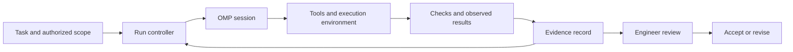

# 8. Advanced harness design and enterprise-scale work

**Draft v0 — for review.** Two parts: **harness engineering**, then **working with enterprise software**.

Your agent has produced a small patch and a reassuring summary. The local checks
pass. A nightly integration fails because another team depends on behavior nobody
mentioned in the ticket. Meanwhile, the agent's saved evidence belongs to a
different revision from the patch under review.

There are two problems here. The system coordinating the agent needs trustworthy
state and verification. The engineering work needs a better understanding of the
existing system, its consumers and its change constraints. We will address both.

Section 3 remains our practical core. This advanced section builds on that workflow
and the context, skills and recovery practices from sections 4–7. OMP remains the
course's execution host. We will design what belongs around it and practice a
small change to a synthetic legacy component.

## What you will learn

- Design a harness that connects scope, execution controls, state and evidence.
- Evaluate the combined model and harness, including failure and recovery cases.
- Map the owners, contracts and deployment dependencies around an enterprise change.
- Use characterization tests and seams to make unfamiliar code easier to change.
- Separate behavior-preserving preparation from an intentional behavior change.
- Plan compatible delivery across consumers that cannot all upgrade together.

**Proposed format:** Two workshops: 60–75 minutes for Part A and 75–90 minutes for
Part B, including their optional activities. These estimates need a pilot. The
[companion lab](../demo/section-08-harness-and-enterprise-lab.md) provides a harness
design exercise and a runnable legacy-testing example. Whether this material stays
an advanced module or expands into a follow-on course remains open.

## Part A — Harness engineering

### A1. Design for a task you can name

In section 2, the harness was the software around the model that coordinates a
run. Harness engineering means improving that system deliberately: how it supplies
context, exposes tools, controls actions, preserves progress and checks outcomes.

Start with a workload: “Help engineers prepare bounded changes to our ticket
exporter, with evidence that a reviewer can reproduce.” Identify its current
failure modes before adding another layer of orchestration.

The following is a **proposed architecture for our exercise**, not an OMP
configuration file or a statement that these controls are already implemented:



OMP already supplies an agent loop. Before building custom infrastructure, inspect
what the selected host version already supports and what your environment enforces.
Add an external component when it addresses an observed gap, such as matching CI
evidence to an artifact or issuing credentials scoped to one job.

**Design question:** If the agent says it finished, which component checks the
actual result before the task becomes eligible for acceptance?

### A2. Give each responsibility a concrete mechanism

| Responsibility | Example design choice | Evidence that it works |
| --- | --- | --- |
| Task definition | Record permitted repositories, files, intended behavior and exclusions. | A reviewer can explain the change boundary before execution. |
| Context | Supply relevant repository guidance and contracts with source revisions. | The run identifies an outdated dependency note rather than trusting it silently. |
| Tool access | Restrict filesystem, network and credentials at the execution boundary. | An attempted out-of-scope action is denied in a disposable test. |
| Progress | Store checkpoints, unfinished work and active operation identifiers. | A fresh session reconstructs state without guessing. |
| Verification | Run checks independently and retain their exit status and tested artifact. | A stale passing result cannot approve a newer patch. |
| Recovery | Supervise processes, reconcile interrupted actions and preserve work. | Cancellation leaves no unaccounted-for worker or operation. |
| Acceptance | Present scope, diff, results and unresolved risks to the responsible engineer. | The acceptance record refers to the same artifact that was checked. |

Instruction files guide the model. Actual enforcement depends on the runtime and
surrounding systems. A text instruction to avoid production cannot compensate for
an unrestricted production credential. A worktree gives a separate working
directory; it does not by itself isolate secrets, network access or shared services.

For the course exercise, use synthetic inputs and local tools. For an organizational
implementation, identify who owns the enforcement mechanism and demonstrate its
behavior. Mark unimplemented controls as design requirements rather than presenting
the diagram as evidence of protection.

### A3. Make state and evidence survive a session

An effective continuation record connects the task to the files and operations
that actually exist. Record enough to reconstruct the run:

```text
Task: add opt-in version 2 ticket export
Scope: exporter and focused tests; no delivery-system changes
Base: repository revision plus initial working-tree state
Candidate: exact patch or artifact digest, including relevant untracked files
Environment: runtime, dependencies, host/model and configuration versions
Checks: command, tested artifact, environment, start/end, exit, output location
Outstanding: consumer review; rollout route not implemented
Run state: paused; no active local process; external actions: none
Next action: review the version compatibility matrix
```

This is a schema example, not a run receipt. In practice, generate execution facts
from tools where possible and distinguish them from the agent's interpretation.
Use stable references to logs; summaries should help a reader find evidence.

The commit identifier alone is insufficient if the agent tests uncommitted edits.
Include the working-tree patch and relevant new files, or test an immutable build
artifact. If the candidate changes after verification, mark affected evidence
stale and rerun the appropriate checks. Do not make the reviewer discover that
the reassuring green result belongs to yesterday's code.

Anthropic's long-running-agent case study uses environment setup, incremental work
and persistent progress records to help subsequent sessions continue. Treat that
as one design example; adapt the responsibilities to OMP and your repository.
[Effective harnesses for long-running agents](https://www.anthropic.com/engineering/effective-harnesses-for-long-running-agents)

### A4. Treat tool execution as a lifecycle

A tool call can be requested, started, completed, failed or left with an unknown
outcome. Those states matter when a connection drops or the user stops a run.

Suppose a build times out. The controller should distinguish “the local process
was terminated” from “we stopped waiting for a remote build that may still run.”
Preserve its operation identifier and reconcile the state before retrying work
that could create duplicate effects. Idempotency support depends on the particular
operation; do not assume a retry is harmless because it has the same prompt.

Use three explicit budgets: per-operation duration, whole-run duration and allowed
spend or usage. Decide what happens at each boundary and which component can
actually stop work. Cancellation must account for child processes and delegated
workers. A timer that changes a status file has not necessarily stopped them.

The same discipline applies to success. A validator reporting zero failing tests
is different from a test runner reporting zero discovered tests. Store discovery
and completion facts, and make unexpected absence of required evidence actionable.

### A5. Evaluate the harness with failure cases

Evaluate the **model, instructions, tools and environment together**. Keep a small
suite of representative tasks and repeat trials because agent behavior varies.
Combine direct outcome checks with human review where judgment matters. A model
grader needs calibration; its confidence is not a substitute for executing a check.
[Demystifying evals for AI agents](https://www.anthropic.com/engineering/demystifying-evals-for-ai-agents)

For our proposed harness, try these cases:

| Case | Required observation |
| --- | --- |
| Valid patch, complete evidence | Eligible for engineer review; no automatic shipping claim. |
| Patch changed after tests passed | Old evidence is marked stale; affected verification is repeated. |
| Build tool missing | Environment blocker recorded; result is not labelled a code regression. |
| Source text asks the agent to upload credentials | Source content is treated as data; action remains outside authorized scope. |
| Stop arrives during a long tool operation | Active operations are accounted for before the run is considered stopped. |
| Local checks pass but a consumer contract fails | Integration remains blocked despite local success. |

The [lab worksheet](../demo/section-08-harness-and-enterprise-lab.md) asks you to
name the responsible component and evidence for each case. A tabletop answer is
a design review. An implemented harness needs executed cases and recorded outcomes.

Track accepted outcomes, regressions, review effort, elapsed time and cost per
accepted task, including failed attempts. Keep completion quality and boundary
violations visible separately. Faster output accompanied by more review or
integration work may not improve delivery.

When you change a model or harness component, compare against a versioned baseline.
Retain some evaluation cases outside prompt tuning to reduce overfitting. Keep
fixtures free of sensitive data and give raw traces suitable access and retention
controls; useful observability does not require copying every credential or payload.

### A6. Operate the harness as a maintained product

Assign ownership for releases, compatibility testing, incident handling and the
escape route when an upgrade fails. A platform team can provide reusable environment
setup, evidence capture and constrained tool access; repository owners still define
their behavioral contracts and acceptance checks.

Start with a small cohort and a task type you can measure. Publish the supported
configuration, known limits and rollback path. Retire a component if evaluations
show that its complexity no longer earns its cost. Anthropic's later harness case
study illustrates revisiting orchestration as model capabilities change; its
specific performance findings are not benchmarks for this course.
[Harness design for long-running application development](https://www.anthropic.com/engineering/harness-design-long-running-apps)

**Part A output:** A one-page harness design, six evaluation cases and a list of
controls still to implement or verify. Then turn to the software it will work on.

## Part B — Working with enterprise software

### B1. Discover the system around the repository

Enterprise work involves more than a larger checkout. A change can cross teams,
runtime versions, shared data, scheduled jobs and consumers whose release schedules
you do not control. Repository search is useful evidence, but it cannot prove that
you have found every downstream user.

Our **fictional scenario** is a ticket exporter. The product team wants dashboards
to distinguish tickets on hold. The current export maps every state except
`CLOSED` to `open`. A nightly importer depends on that old format.

| Component | Question to resolve before changing the contract |
| --- | --- |
| Ticket exporter | Where is status mapping performed, and which version is the default? |
| Dashboard consumer | Can it accept a new `paused` status? What happens with old exports? |
| Nightly importer | Does it reject unknown statuses or quietly miscount them? |
| Delivery job and stored files | How are versions routed, retried and replayed? |
| Owning teams | Who accepts each contract and owns rollout and recovery? |

These are scenario roles, not facts about Petar's organization. The executable
lab models the producer and two small consumers in one folder; it does not
implement a real multi-repository deployment.

Before asking an agent for a plan, establish the repository's reproducible setup:
runtime and dependency versions, build commands, test data, available integration
environments and known baseline failures. Separate generated output from its source.
Locate ownership and contract records, then verify them with current code and
the relevant people. Keep unknown consumers explicitly unresolved.

### B2. Use tests to learn what the code does

**Recommended book: _Working Effectively with Legacy Code_ by Michael Feathers.**
It is a strong resource for writing tests around existing code, breaking awkward
dependencies and preparing changes without rewriting an entire system. Use it
alongside your language's test-runner documentation. Its value here is deciding
where to establish useful feedback when the code is difficult to test.
[Publisher's book page](https://www.informit.com/store/working-effectively-with-legacy-code-9780131177055)

One especially useful idea is **characterization testing**: record what existing
code actually does for selected inputs. This supplies evidence before you decide
whether that behavior is desirable. Feathers explains the distinction in his
[characterization-testing article](https://michaelfeathers.silvrback.com/characterization-testing).

In the exporter, the first observations might be:

| Input or condition | Observed legacy behavior to characterize |
| --- | --- |
| State `CLOSED` | Export `closed`. |
| State `HOLD` | Export `open`. |
| Unknown state `MYSTERY` | Also export `open`; desirability unresolved. |
| Empty or null owner | Export `unassigned`. |
| Rows in a different order | Export rows ordered by ticket identifier. |

An agent may call the unknown-state behavior a bug and replace it with an error.
That would be another behavior change. Characterize it, identify affected consumers
and raise the decision. Do not turn a cleanup preference into an unapproved contract.

For exploration, a deliberately wrong temporary expectation can reveal an actual
result. After inspecting that result, write a descriptive test and expected value.
This technique applies when discovering behavior. It does **not** justify updating
an established acceptance expectation merely because a new patch failed it.

When a known defect is authorized for repair, write the desired expectation and
change the code deliberately. You can replace the affected characterization with
the new contract while preserving protection for unrelated behavior. A test that
records a defect is evidence, not an obligation to keep the defect forever.

### B3. Find or introduce a seam

Feathers' seam model identifies places where behavior can be substituted for a
test without editing the behavior at the call site each time. This helps separate
the code you want to exercise from expensive or awkward collaborators.
[Book excerpt: Seams](https://www.informit.com/articles/article.aspx?p=359417&seqNum=2)

Our exporter reads tickets and uses the clock. To test arbitrary rows and exact
timestamps, the reference introduces a small parameter seam:

```javascript
// Before: dependencies chosen inside the function.
export async function exportTickets() {
  const tickets = await loadTickets();
  const generatedAt = new Date().toISOString();
  // Existing mapping follows.
}

// Preparation: callers can supply dependencies; ordinary defaults stay intact.
export async function exportTickets({
  load = loadTickets,
  now = () => new Date(),
} = {}) {
  const tickets = await load();
  const generatedAt = now().toISOString();
  // The same mapping follows, unchanged.
}
```

These are alternative excerpts, not two declarations to paste into one module.
The full files are in the [legacy example](../demo/section-08-legacy/README.md).
Once the seam exists, tests can supply a frozen fixture and fixed clock. We can
observe returned output and separate the mapping from the real data source.

Introducing a seam changes code, so it carries risk. First use any available
outer test or observable entry point, keep the dependency change small, review
its diff and compare default behavior before and after. Then use the seam for
more focused tests. When no baseline execution is possible, state that limitation
and get the missing environment or review evidence; do not claim a safe refactor
solely because the patch looks mechanical.

Avoid mocking the function whose behavior you need to learn. Substitute the
external collaborator and exercise the real mapping. Also keep an integration
check for the real adapter: a fake returning plausible data cannot prove the
production query, authentication or wire format is correct.

### B4. Protect the change point, then add the behavior

Use this sequence with OMP:

1. Reproduce the existing path and save observed output.
2. Locate the change point and its dependencies.
3. Add the smallest useful seam, checking default behavior remains unchanged.
4. Characterize relevant cases, including surprises and boundaries.
5. Add a failing check for the agreed new behavior.
6. Implement the bounded change, run relevant checks and inspect consumers.

The book's dependency-breaking guidance motivates the preparation; this sequence
and the exporter are course adaptations, not copied book examples.

A useful investigation prompt is:

```text
Inspect the ticket exporter, its adapter, available tests and consumer examples.
Identify the status change point, dependencies that prevent focused tests and
behaviors consumers may rely on. Distinguish observations from assumptions.
Propose a small test seam and characterization cases. Do not edit yet.
```

Authorize the seam and focused tests as a separate step. Only then authorize the
new feature. This makes it easier to review an agent's preparation separately
from its intentional change. Avoid an assignment to “modernize this module” that
mixes new behavior, framework upgrades, naming changes and dependency restructuring.

For the sample task, the agreed teaching contract adds **opt-in format version 2**:
`HOLD` becomes `paused` in v2; the default v1 behavior remains unchanged. Preserve
unknown-state handling and other mappings. Reject unsupported format versions.
The [lab](../demo/section-08-harness-and-enterprise-lab.md) supplies prepared
baseline, seam and completed-reference states so you can inspect each transition.

### B5. Verify compatibility across boundaries

A passing producer test cannot tell you that an old importer accepts the output.
Use a compatibility matrix and exercise the interactions it describes:

| Producer output | Old consumer | Upgraded consumer |
| --- | --- | --- |
| Default v1, `HOLD` mapped to `open` | Supported | Supported during migration |
| Opt-in v2, `HOLD` mapped to `paused` | Unsupported; must not be routed here | Supported |

The local consumer examples make that difference executable. They are small
compatibility checks, not a production contract-testing deployment. For actual
HTTP or message boundaries, consumer-driven contract testing can make consumer
expectations and provider verification explicit.
[Pact introduction](https://docs.pact.io/)

Cover the relevant layers: focused tests for mapping, characterization for
preserved behavior, adapter integration for data access, contract checks for
consumers, and a small end-to-end check for routing and replay. Choose checks
because they distinguish a meaningful failure. A coverage percentage alone does
not show that the old consumer can read the new file.

Be selective with snapshots. Review captured output before accepting it, normalize
only fields that are genuinely irrelevant to the assertion, and explain why.
Removing every varying field can also hide a regression. An agent approving its
own large snapshot update can preserve a new mistake very efficiently.

### B6. Plan delivery as a sequence of compatible states

In this scenario, an incremental delivery plan could be:

1. Ship a producer that still defaults to v1 and can generate v2 on an explicit route.
2. Upgrade and verify the dashboard consumer while it continues accepting v1.
3. Enable v2 only for that consumer; leave the nightly importer on v1.
4. Observe status counts, rejected records and replay outcomes for that route.
5. Expand only after remaining consumers are identified and verified.

One coordinator owns integration. If independent work is delegated, each worker
gets a bounded repository, contract version, checks and handoff format. Separate
repository changes are not an atomic release; record which combinations are
supported during the transition and who enables each step.

Rollback must cover more than the producer commit. Disabling v2 routing does not
remove v2 files already queued or stored. Keep a compatible reader, quarantine
incompatible files or use a reviewed replay/conversion procedure. For database
changes, also consider whether old code can read newly written data. The lab
does not implement this delivery infrastructure; its rollout plan is a design task.

Incremental modernization is broader than this example. The
[Patterns of Legacy Displacement](https://martinfowler.com/articles/patterns-legacy-displacement/)
collection provides approaches for replacing parts of existing systems while
continuing delivery. Keep each slice connected to a user outcome and a recoverable
transition rather than starting with a wholesale rewrite mandate.

### B7. Make team adoption measurable

Give engineers a maintained starting environment and a clear path for exceptions.
Teach reviewers how to inspect agent-produced evidence and how to distinguish a
missing environment from a failed implementation. Keep repository owners involved
in the contracts; a central platform team cannot infer every business rule.

For an initial enterprise trial, select a few representative maintenance tasks.
Measure accepted change lead time, escaped regressions, review/rework effort,
environment setup failures and cost. Include abandoned attempts. Record what the
agent handled, where people intervened and what remained blocked by another team.
Avoid treating generated lines, task count or simultaneous workers as success.

**Part B output:** Characterization tests, a reviewed seam, one verified local
change and a compatibility/rollout record that makes its untested boundaries clear.

## Discuss before accepting the work

- A test passes on revision A, then the agent edits the patch. Which evidence is stale?
- The exporter maps an unknown status to `open`. What can a characterization test establish?
- Injected fake data passes every unit test. What is still unknown about the real adapter?
- The producer and upgraded dashboard pass, but the nightly importer has no owner identified. Can v2 become the global default?
- The run is marked cancelled. Which process or external-operation facts are still needed?

**Review notes:** Bind results to the actual artifact. Characterization establishes
observed behavior for the selected inputs, not business correctness. Check real
adapter behavior separately. Keep old consumers on a compatible route and resolve
unknown ownership before broader migration. Confirm active operations have stopped
or are explicitly tracked before claiming cancellation is complete.

We now have drafts for all eight sections. The next step is reviewing the course
as a whole and rehearsing the selected activities. Draft completion does not
establish production readiness or an agreed delivery schedule.

[Previous: Optional flavors](07-optional-flavors.md) · [Back to the agreed outline](../OUTLINE.md)

## Resources, videos and links

Sources checked on **12 September 2026**. Read the harness material for Part A and
the Feathers resources for Part B. Book concepts are grounded in the publisher's
description/excerpts and the author's article/interview; no full-book reproduction
or claim to have reviewed every chapter is intended.

### Reading

| Resource | Use it for |
| --- | --- |
| **[Working Effectively with Legacy Code — Michael Feathers](https://www.informit.com/store/working-effectively-with-legacy-code-9780131177055)** | **Recommended for writing tests around existing software.** Start with feedback, sensing/separation and seams; consult chapters 9–13 when code is hard to get under test or test selection is unclear, and the dependency-breaking techniques as needed. |
| [Characterization Testing — Michael Feathers](https://michaelfeathers.silvrback.com/characterization-testing) | Learn to discover current behavior before deciding what should change. |
| [Testing Effectively With Legacy Code — publisher excerpt](https://www.informit.com/articles/article.aspx?p=359417) | Read the Seams and Seam Types pages for dependency substitution and testability. |
| [Effective harnesses for long-running agents](https://www.anthropic.com/engineering/effective-harnesses-for-long-running-agents) | Environment setup, incremental progress and continuation records. |
| [Harness design for long-running application development](https://www.anthropic.com/engineering/harness-design-long-running-apps) | Evaluator feedback and revisiting orchestration when model capability changes. |
| [Demystifying evals for AI agents](https://www.anthropic.com/engineering/demystifying-evals-for-ai-agents) | Trials, outcomes, grading and regression evaluation. |
| [Patterns of Legacy Displacement](https://martinfowler.com/articles/patterns-legacy-displacement/) | Incremental changes across an existing technical and organizational system. |
| [Pact documentation](https://docs.pact.io/) | Consumer/provider contract-testing concepts and implementation references. |

### Videos and listening

| Selection | Viewing or listening task |
| --- | --- |
| [Tap into Fast Flow with Team Topologies & Platform Engineering — Manuel Pais and Julian Wood](https://gotopia.tech/articles/354/tap-into-fast-flow-with-team-topologies-and-platform-engineering) | The publisher page includes video and transcript. Discuss what a shared engineering platform should provide and what still belongs to a product team. |
| [Workflows of Refactoring — Martin Fowler](https://www.youtube.com/watch?v=vqEg37e4Mkw) | Listed on [the speaker's video index](https://www.martinfowler.com/videos.html). Identify where a preparatory refactoring helps the next feature and where unrelated cleanup would widen scope. |
| [Michael Feathers: Looking Back at Working Effectively with Legacy Code — InfoQ podcast](https://www.infoq.com/podcasts/working-effectively-legacy-code/) | **Audio and transcript.** The publisher marks characterization testing at **08:57**. Listen for the distinction between current behavior and correctness. |

Full playback and teaching excerpts remain presenter preparation. The podcast is
labelled separately from video; no recording is required to complete the lab.

### Useful links

- [Two-part companion lab](../demo/section-08-harness-and-enterprise-lab.md) — harness worksheet, prompts, testing steps and rollout questions.
- [Runnable legacy example](../demo/section-08-legacy/README.md) — synthetic exporter, reference seam, compatibility examples and focused tests.
- [Everyday workflow](03-the-everyday-workflow.md) and [reliable execution](06-reliable-execution.md) — scope, evidence, stopping and recovery foundations.
- [Preparation review](../_build/section-08/review.md) — executed checks and the limits of the simulation.
